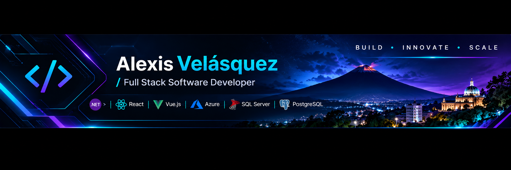

# 👨‍💻 Alexis Velásquez | Full Stack Software Developer

  

  
  
  

<h2 align="center">BUILD · INNOVATE · SCALE</h2>

  <b>Turning ideas into scalable software solutions.</b>

---

## 👋 About Me | Sobre mí

### 🇬🇧 English

I'm a Full Stack Software Developer with over **6 years of professional experience in .NET development**, focused on building scalable, maintainable and reliable software solutions.

My experience includes backend development, REST APIs, enterprise applications, database design, software architecture and modern frontend technologies.

I enjoy solving complex problems, exploring new technologies and transforming business requirements into effective software solutions.

**Currently focused on:**
- Backend development with C# and .NET.
- Full Stack applications with React and Vue.js.
- Clean Architecture and Hexagonal Architecture.
- REST APIs and system integrations.
- Database design and optimization.
- Cloud technologies and DevOps practices.

### 🇸🇻 Español

Soy desarrollador de software Full Stack con más de **6 años de experiencia profesional en desarrollo .NET**, enfocado en construir soluciones de software escalables, mantenibles y confiables.

Tengo experiencia en desarrollo backend, APIs REST, aplicaciones empresariales, diseño de bases de datos, arquitectura de software y tecnologías frontend modernas.

Me apasiona resolver problemas complejos, explorar nuevas tecnologías y transformar requerimientos de negocio en soluciones de software eficientes.

**Actualmente enfocado en:**
- Desarrollo backend con C# y .NET.
- Aplicaciones Full Stack con React y Vue.js.
- Clean Architecture y Arquitectura Hexagonal.
- APIs REST e integración de sistemas.
- Diseño y optimización de bases de datos.
- Tecnologías Cloud y prácticas DevOps.

---

## 🛠️ Tech Stack

### Backend Development

  

### Frontend Development

  

### Databases

  

### DevOps, Cloud & Tools

  

### Other Technologies

- Apache Kafka
- RabbitMQ
- Keycloak
- SQL Server
- Oracle Database
- Azure DevOps
- IIS

---

## 🧠 Areas of Expertise | Áreas de especialización

| Area | Technologies |
|---|---|
| Backend Development | C#, .NET 7/8, ASP.NET Core |
| Frontend Development | React, Vue.js, JavaScript, TypeScript |
| Software Architecture | Clean Architecture, Hexagonal Architecture |
| API Development | REST APIs, Microservices, Integrations |
| Databases | SQL Server, PostgreSQL, MySQL, Oracle, MongoDB |
| Messaging | Apache Kafka, RabbitMQ |
| Security | Keycloak, Authentication, Authorization |
| DevOps | Docker, Azure DevOps, GitHub Actions, IIS |

---

## 📊 GitHub Analytics

  
  

  

---

## 📈 Contribution Activity

  

---

## 🚀 Featured Projects | Proyectos destacados

### 💳 [TarjetasCore](https://github.com/kalevelasquez/TarjetasCore)

Card management project developed with C#.

**Technology:** C#

### 🕷️ [Market Scrapping](https://github.com/kalevelasquez/market-scrapping)

Market scraping application focused on collecting and processing information.

**Technology:** HTML

### 🏥 [GSHospitalsCommandCenter](https://github.com/kalevelasquez/GSHospitalsCommandCenter)

Hospital command center project.

**Technology:** HTML

### 🐍 [Python Trix](https://github.com/kalevelasquez/python-trix)

Collection of Python scripts and utilities.

**Technology:** Python

---

## 🎯 What I'm Interested In | Mis intereses

- Building scalable enterprise applications.
- Backend engineering and software architecture.
- Cloud infrastructure and DevOps.
- Application security and secure development.
- Continuous learning and technology exploration.

---

## 🤝 Let's Connect | Conectemos

  
  
  <!-- Add your LinkedIn profile URL here -->

  <i>"Great software is built through continuous learning, collaboration and attention to detail."</i>

  <b>⚡ Keep coding. Keep growing. 🚀</b>

